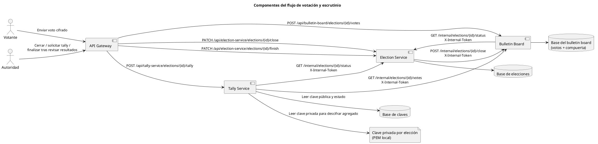
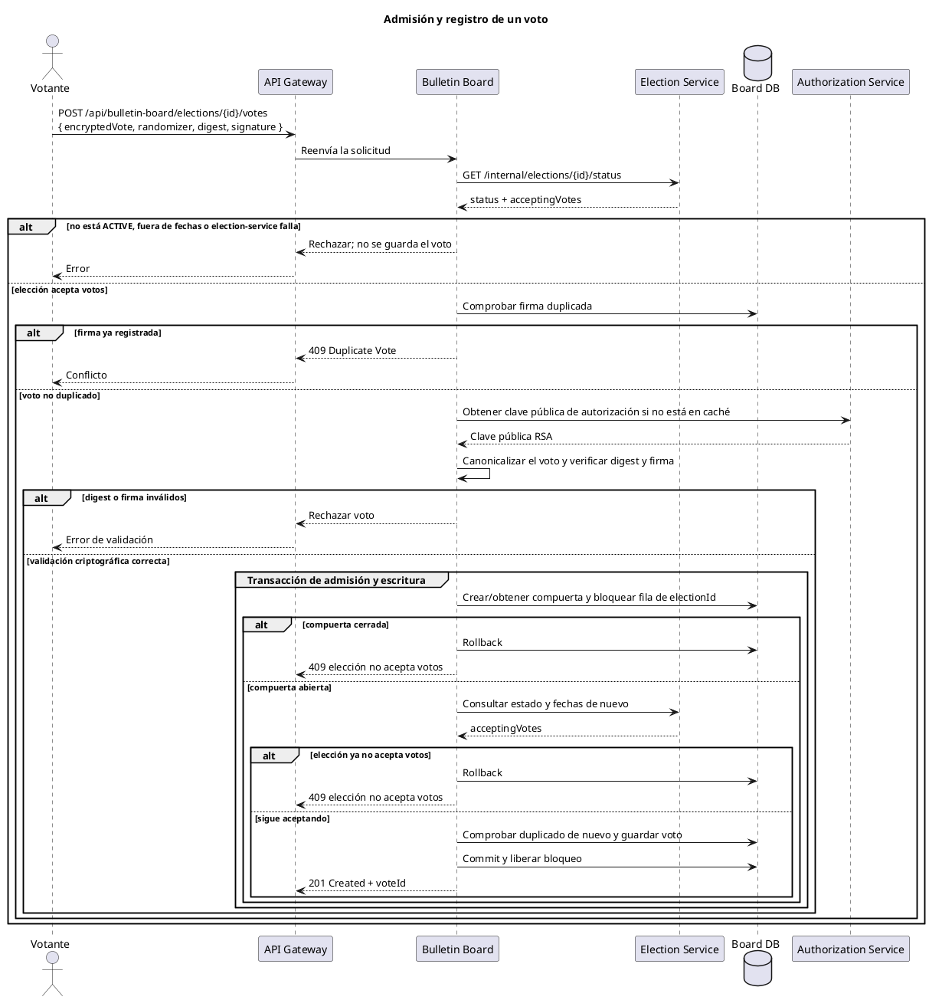
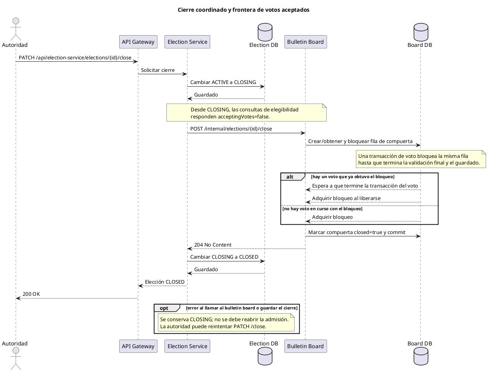
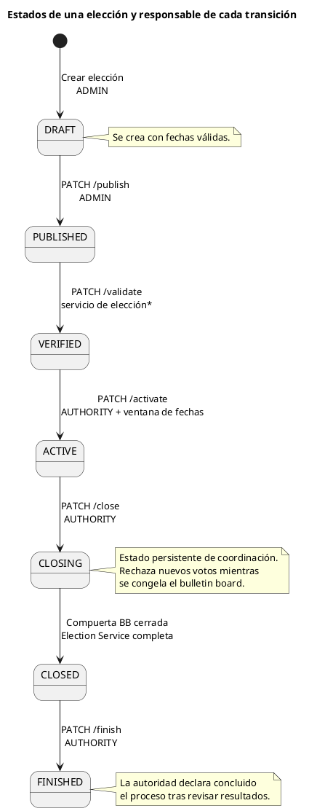
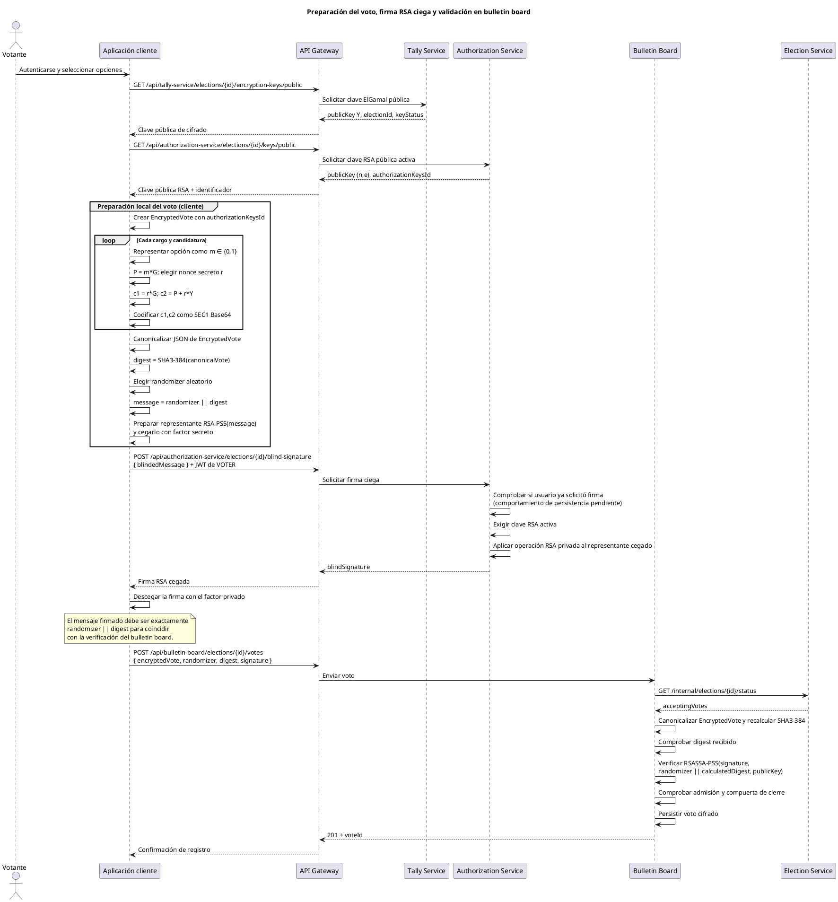

# Flujo de admisión de votos y escrutinio homomórfico

Este documento describe el flujo implementado entre `api-gateway`, `election-service`, `bulletin-board` y `tally-service`. Los diagramas están en PlantUML para poder incluirlos o renderizarlos en la documentación técnica.

## 1. Componentes y responsabilidades



Las rutas `/internal/**` son llamadas entre servicios y requieren el encabezado `X-Internal-Token`. Configurar `INTERNAL_SERVICE_TOKEN` con un valor no vacío e idéntico en los servicios participantes. En despliegue, las URLs de servicio deben apuntar a direcciones privadas. Este token compartido es la configuración actual; una integración con clientes confidenciales de Keycloak puede reemplazarlo para utilizar credenciales y permisos distintos por servicio.

## 2. Recepción de un voto

El bulletin board consulta la elegibilidad antes de hacer trabajo criptográfico y vuelve a consultarla antes de persistir. La compuerta por elección se bloquea dentro de la misma transacción que guarda el voto: esto coordina la última comprobación y la escritura con la operación de cierre.



`acceptingVotes` solo es verdadero cuando el estado es `ACTIVE` y la hora está en el intervalo semiabierto `[startDate, endDate)`. Si la elección no existe, la llamada devuelve error y no se registra el voto. Si el servicio de elecciones no responde, la solicitud falla cerrada: el bulletin board tampoco lo acepta.

## 3. Cierre coordinado de la elección

`CLOSING` no es un estado de votación ni un estado final. Es la barrera durable que se escribe en election-service **antes** de contactar al bulletin board: desde ese momento las comprobaciones de elegibilidad no aceptan nuevos votos. Después se cierra la compuerta local de admisión.



La compuerta y la escritura del voto usan la misma base de datos y la misma fila bloqueada por elección. Si un voto ya pasó la consulta inicial a election-service cuando empezó el cierre, la segunda consulta —después de obtener el bloqueo— detecta `CLOSING` y aborta. Si el voto obtuvo primero el bloqueo y pasó esa segunda consulta, el cierre espera a que la transacción termine; por tanto, ese voto forma parte del conjunto cerrado. Los votos de otras elecciones utilizan otras filas y no se bloquean entre sí.

El cierre es reintentable: si la elección ya está `CLOSING`, se repite la orden de cerrar la compuerta y luego se completa la transición a `CLOSED`. Si ya está `CLOSED`, la operación no necesita volver a cerrarla.

## 4. Tally homomórfico

El endpoint de tally es `POST /api/tally-service/elections/{id}/tally` y está restringido a autoridades en el gateway. El servicio exige estado `CLOSED` (o `FINISHED` para permitir recalcular) y clave de tally activa. El tally devuelve los conteos y **no cambia** el estado de la elección. Una vez que la autoridad electoral revisa y acepta los resultados, puede finalizarla con `PATCH /api/election-service/elections/{id}/finish`. Ese endpoint exige el rol `AUTHORITY` en el gateway, cambia una elección `CLOSED` a `FINISHED` y es idempotente si ya estaba `FINISHED`.

```plantuml
@startuml
title Lectura, suma homomórfica y descifrado del tally
actor Autoridad
participant "API Gateway" as Gateway
participant "Tally Service" as Tally
participant "Election Service" as Election
participant "Bulletin Board" as Board
database "Board DB" as BoardDB
database "Key DB" as KeysDB
file "Clave privada PEM" as PrivateKey

Autoridad -> Gateway : POST /api/tally-service/elections/{id}/tally
Gateway -> Tally : Ejecutar tally
Tally -> Election : GET /internal/elections/{id}/status
Election --> Tally : status
alt estado no es CLOSED ni FINISHED
    Tally --> Gateway : 409 Election Not Closed
    Gateway --> Autoridad : Rechazo
else cerrado o tally ya finalizado
    Tally -> KeysDB : Consultar clave de la elección
    KeysDB --> Tally : Clave pública + estado
    alt clave no encontrada o no ACTIVE
        Tally --> Gateway : Error de clave
    else clave activa
        Tally -> Board : GET /internal/elections/{id}/votes
        Board -> BoardDB : Leer votos cifrados
        Board --> Tally : Lista de votos
        Tally -> Tally : Decodificar c1,c2 y validar puntos secp256k1
        Tally -> Tally : Agrupar por (electionPositionId, candidacyId)
        Tally -> Tally : Sumar c1 y c2 de cada grupo
        Tally -> PrivateKey : Leer escalar privado x
        PrivateKey --> Tally : x
        Tally -> Tally : M = sum(c2) - x * sum(c1)
        Tally -> Tally : Resolver M = count * G,\n0 <= count <= ciphertexts del grupo
        alt punto inválido o resultado fuera del rango
            Tally --> Gateway : 422 Invalid Ciphertext
        else resultados válidos
            Tally --> Gateway : 200 + conteos por cargo/candidatura
            Gateway --> Autoridad : Resultados y cantidad de votos procesados
            opt autoridad revisa y acepta resultados
                Autoridad -> Gateway : PATCH /api/election-service/elections/{id}/finish
                Gateway -> Election : Solicitar finalización\n(rol AUTHORITY)
                Election -> Election : Validar estado CLOSED\n y cambiar a FINISHED
                Election --> Gateway : 200 + estado FINISHED
                Gateway --> Autoridad : Elección finalizada
            end
        end
    end
end
@enduml
```

### Contrato criptográfico esperado

Para cada candidatura/cargo, `vote.c1` y `vote.c2` son puntos de la curva `secp256k1`, serializados en SEC1 y codificados en Base64. El cifrado debe ser ElGamal aditivo:

```text
Y = x * G                         clave pública
m ∈ {0, 1}                        voto binario
P = m * G                         punto que representa el voto
c1 = r * G
c2 = P + r * Y

sum(c1) = Σ c1
sum(c2) = Σ c2
M = sum(c2) - x * sum(c1)         punto agregado descifrado
M = count * G                     count ∈ [0, cantidad de ciphertexts]
```

La propiedad homomórfica permite sumar componentes de los ciphertexts sin conocer los votos individuales. El código no descifra cada ballot: descifra un punto agregado por candidatura y busca el múltiplo de `G` dentro de un rango acotado por el número de ciphertexts del grupo.

## 5. Límites y consideraciones antes de producción

- El tally comprueba que los puntos recibidos se puedan decodificar y sean puntos válidos de la curva, y rechaza resultados que no correspondan a un conteo dentro del rango permitido.
- El flujo **asume** que el productor cifra solamente `0` o `1`. No verifica todavía una prueba de conocimiento cero que pruebe la restricción de bit ni que el voto cumpla la regla electoral de selección única. Una firma de autorización valida la firma sobre el voto, pero no reemplaza esas pruebas criptográficas.
- El formato de ballots actual agrupa ciphertexts presentes por cargo y candidatura. Asegúrense de que el cliente construya un ciphertext de 0/1 para cada opción según el modelo electoral, para que el tally incluya también los ceros.
- La clave privada actual se guarda como archivo PEM local y el tally usa un único custodio. Este diseño no es umbral: restringir el endpoint de tally y proteger el almacenamiento de claves es esencial. El descifrado umbral queda como evolución posterior.
- El endpoint de finalización registra la decisión de la autoridad y valida la transición de estado, pero no almacena ni verifica una copia de los resultados del tally. La autoridad debe ejecutar el tally, revisar los resultados obtenidos y luego solicitar explícitamente la finalización. La elección permanece `CLOSED` hasta esa decisión.

## 6. Estados: elección y claves

### Ciclo de vida de una elección



`ADMIN` crea y publica en las reglas del API Gateway. `AUTHORITY` activa, cierra y finaliza. La transición `PUBLISHED → VERIFIED` existe en el servicio y tiene endpoint `PATCH /{electionId}/validate`; el gateway actual no contiene una regla específica para ese endpoint, por lo que cae en `.anyExchange().authenticated()`. El asterisco indica esta diferencia entre la ruta y el control de rol actual.

`ACTIVE → CLOSING → CLOSED` son dos pasos porque interviene el bulletin board. `CLOSING` ya bloquea la admisión a través de la consulta autoritativa, y `CLOSED` solo se persiste después de que el bulletin board confirme que cerró la compuerta. `CLOSED → FINISHED` es una decisión posterior y explícita de la autoridad. El sistema no pasa automáticamente una elección a `FINISHED` al completar el cálculo.

### Ciclo de vida de claves

```plantuml
@startuml
title Estados de claves de autorización y de cifrado de tally

state "Clave pública de autorización\n(RSA BSSA)" as AuthKey {
    [*] --> AuthCreated : POST /keys\nAUTHORITY
    AuthCreated --> AuthActive : PATCH /keys/activate\nAUTHORITY
    AuthActive --> AuthExpired : expire() en el dominio\n(sin endpoint expuesto)
}

--

state "Clave de cifrado de tally\n(ElGamal secp256k1)" as TallyKey {
    [*] --> TallyCreated : POST /encryption-keys\nAUTHORITY
    TallyCreated --> TallyActive : PATCH /encryption-keys/status\nkeyStatus=ACTIVE\nAUTHORITY
    TallyActive --> TallyExpired : PATCH /encryption-keys/status\nkeyStatus=EXPIRED\nAUTHORITY
}

note right of AuthActive
El cliente la obtiene por GET /keys/public.
El Authorization Service usa la privada
para firmar ciegamente.
end note
note right of TallyActive
El cliente obtiene la pública para cifrar.
Tally usa la privada para descifrar
el agregado, nunca cada voto individual.
end note
@enduml
```

Las claves de autorización y las claves de cifrado de tally son distintas y no deben confundirse. Ambas tienen estados de dominio `CREATED`, `ACTIVE`, `EXPIRED`. La clave pública RSA activa se sirve por `GET /api/authorization-service/elections/{id}/keys/public`; la clave pública ElGamal se sirve por `GET /api/tally-service/elections/{id}/encryption-keys/public`. La clave privada RSA se conserva en Authorization Service y la privada ElGamal se conserva actualmente en un PEM local de Tally Service.

Los endpoints públicos actuales de administración permiten crear y activar las claves; el estado de clave de tally también se puede cambiar a `EXPIRED`. Para claves RSA existe `expire()` en el modelo, pero no hay endpoint para invocarlo. La activación de elección no verifica automáticamente que ambas claves estén creadas y activas: el operador debe completar este pre-requisito durante la preparación.

## 7. Protocolo de autorización y firma ciega

El siguiente diagrama presenta el **contrato criptográfico esperado para el cliente**, junto con las operaciones del servidor que sí están implementadas. No hay código de aplicación cliente en este repositorio que implemente el cifrado ElGamal, la preparación PSS ciega ni el descegado; esos pasos del lado cliente se muestran como protocolo requerido, no como comportamiento ya verificado en el repositorio.



### Interpretación de los datos y límites actuales

1. **Cifrado del voto.** Para cada opción, el cliente cifra `m ∈ {0,1}` como punto `P=mG` y produce el par ElGamal `(c1,c2)`. El randomness `r` debe ser nuevo e impredecible para cada ciphertext. La API guarda las cadenas, no cifra por sí misma.
2. **Digest.** El bulletin board serializa `EncryptedVote`, lo canonicaliza y calcula `SHA3-384`. `EncryptedVote` incluye `authorizationKeysId` y posiciones/candidaturas; el digest debe cubrir exactamente esa estructura canonicalizada. `randomizer` no forma parte del `EncryptedVote`.
3. **Mensaje firmado.** La verificación implementada en bulletin board comprueba una firma `RSASSA-PSS` con SHA3-384 sobre la concatenación binaria `randomizer || digest`. El orden y codificación deben coincidir en el cliente.
4. **Firma ciega.** El cliente obtiene la firma de un endpoint autenticado con rol `VOTER`; la idea es que Authorization Service firme un representante cegado sin conocer el voto y que el cliente descegue la respuesta. La solicitud de firma está asociada al usuario autenticado y a la elección.
5. **Autorización de clave.** En el bulletin board, `authorizationKeysId` identifica la clave que se usará para validar; si la clave no está en caché, obtiene la clave pública activa de Authorization Service, reconstruye RSA a partir de `(n,e)` y la cachea.
6. **Registro anónimo.** El bulletin board persiste ciphertext, randomizer, digest y firma; no necesita conocer la identidad del votante para validar la firma. Authorization Service sí conoce quién pidió la firma ciega.

**Pendiente importante antes de confiar en la unicidad de la firma ciega:** `BlindSignatureService` comprueba si existe una firma ciega previa para el par usuario/elección, pero la llamada a `blindSignatureRepositoryPort.save(model)` está comentada. Por tanto, con el código actual esa comprobación no deja persistido el registro y no garantiza realmente “una firma por votante y elección”. Hay que persistir de forma transaccional y respaldar con una restricción única en base de datos.

La verificación del bulletin board usa PSS sobre `randomizer || digest`, mientras que Authorization Service aplica la primitiva RSA privada sin padding a `blindedMessage`. Esto es compatible únicamente si el cliente realiza el padding/encoding PSS antes del cegado y el descegado correcto conforme a un esquema RSA blind signature compatible. El cliente no está incluido aquí y esa compatibilidad extremo a extremo aún no está demostrada por tests de protocolo; deben agregarse vectores de interoperabilidad antes de producción. No enviar el digest sin PSS-encoding como `blindedMessage`.

También hay que revisar la gestión de la clave RSA en Authorization Service antes de soportar varias elecciones activas: `RsaBssaService` mantiene un único `KeyPair` mutable como singleton y `loadKeys` no reemplaza una clave que ya está cargada. El identificador de clave que viaja en el voto no selecciona explícitamente el par privado usado por la operación de firma. El diseño objetivo debe resolver claves privadas por `authorizationKeysId`/elección y cargar la correcta para cada solicitud.
